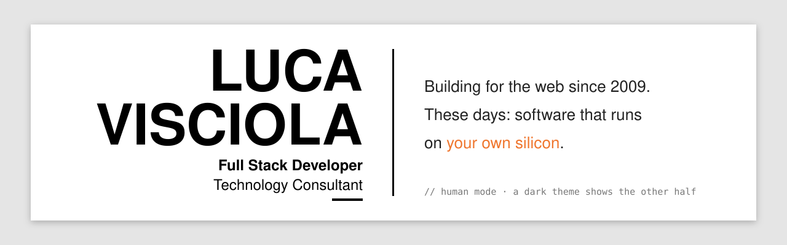
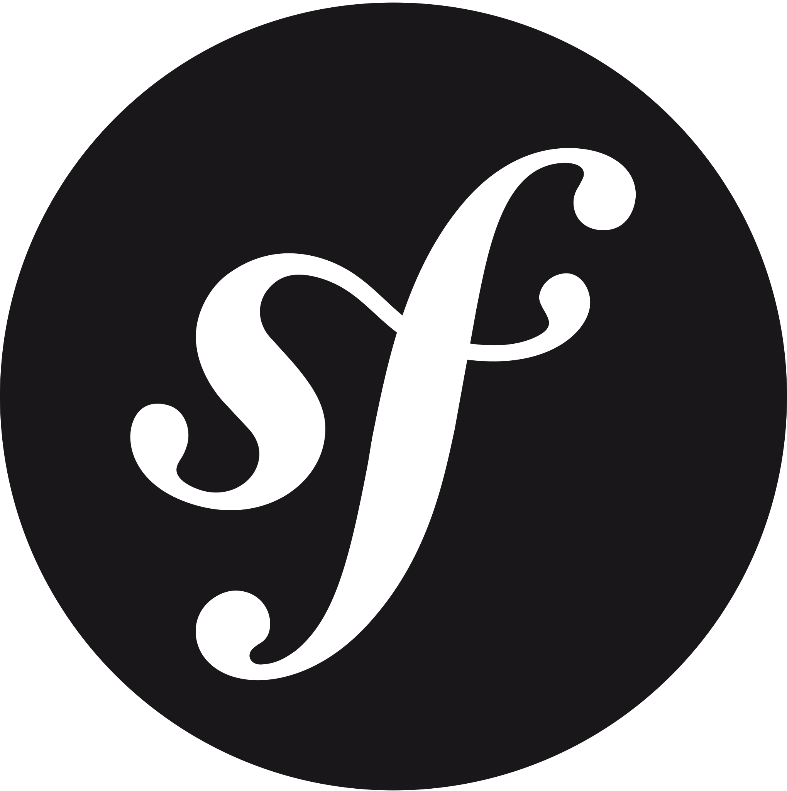
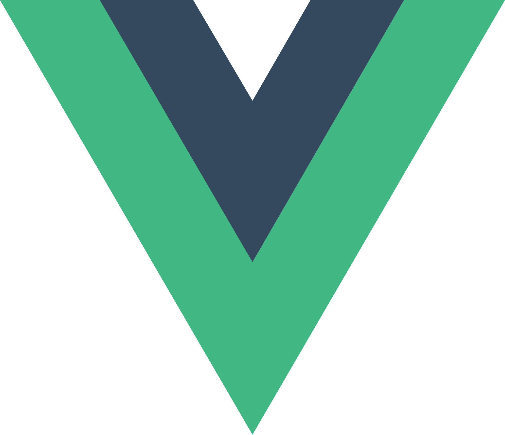
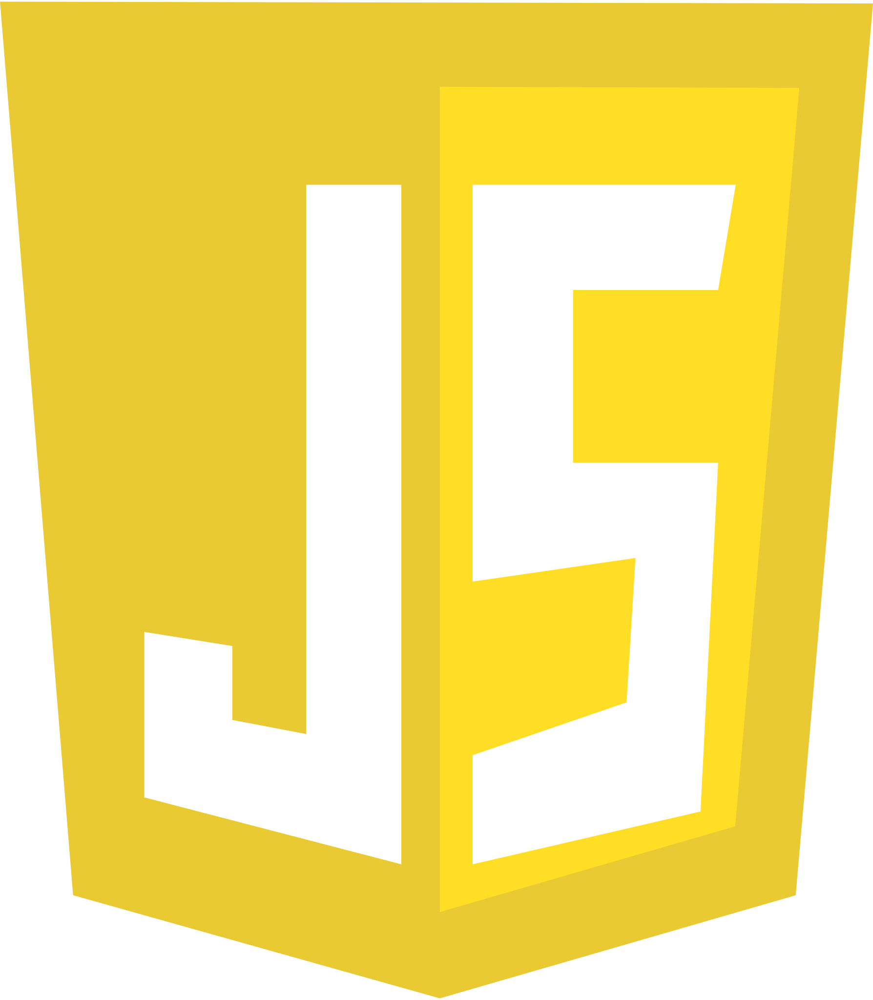
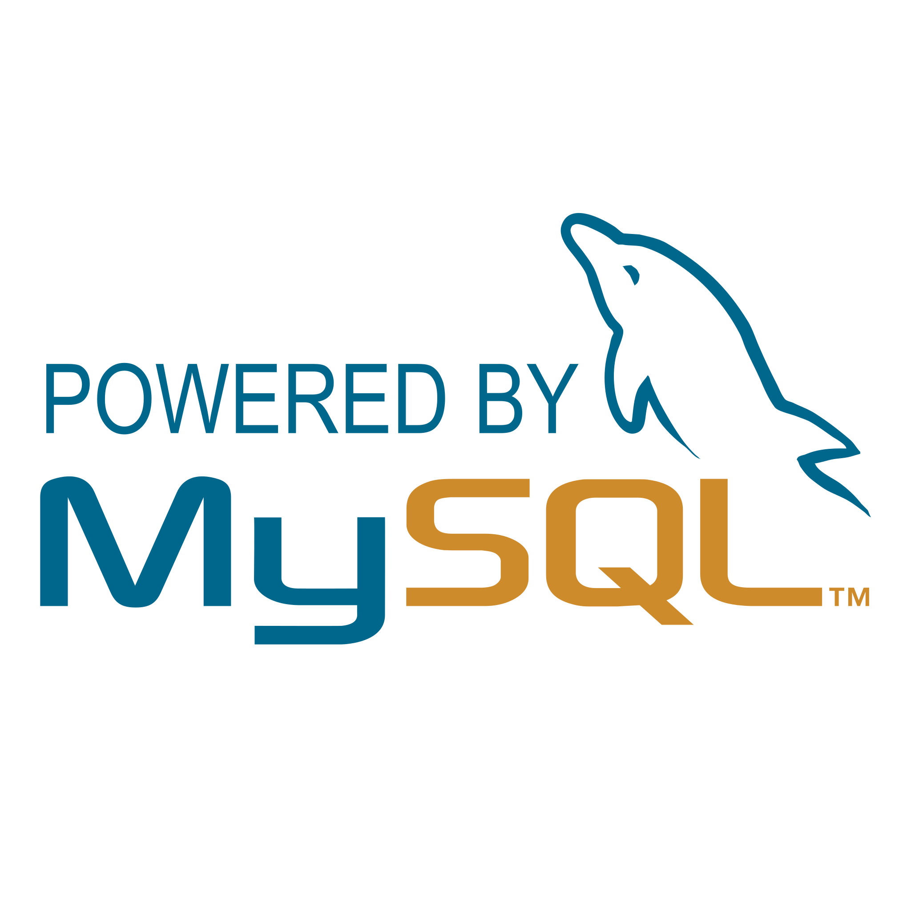

<picture>
  <source media="(prefers-color-scheme: dark)" srcset="assets/readme/banner-machine.svg">
  <source media="(prefers-color-scheme: light)" srcset="assets/readme/banner-human.svg">
  
</picture>

<p align="center">
  <a href="https://resume.lucavisciola.com"><b>resume</b></a> ·
  <a href="https://melasistema.com">melasistema.com</a> ·
  <a href="https://lucavisciola.com">lucavisciola.com</a> ·
  <a href="https://www.linkedin.com/in/luca-visciola/">LinkedIn</a> ·
  <a href="mailto:info@melasistema.com">info@melasistema.com</a>
</p>

> *The duality is only apparent...* The banner above follows your GitHub theme: light for humans, dark for machines. Taking one side or the other won't work.

### `whoami`

A musician before I was a developer, and I never fully stopped being one. Self-taught, which means every abstraction I use I had to take apart first.

Building for the web since 2009 alongside startups, companies and agencies. These days the through-line is **sovereignty**: software that runs on hardware you own, over data that never leaves it.

- **Now:** Full Stack & QA Developer at Metaesse, Bolzano
- **Also now:** building local-first AI in the open, under [Melasistema](https://melasistema.com)
- **Always:** a drummer. Diploma from Drummer Collective, New York, 2005

> **What they say:** *Eager to take every chance to learn more. Decisive, yet open in strategic vision. Comfortable when things get critical.*

### Built in the open

**Local-first AI**

| Project | What it does | More |
|---|---|---|
| [**S-MoE**](https://s-moe.com/) | A 235B frontier model, answering from a laptop SSD. No cloud. No H100. | [docs](https://docs.s-moe.com/) · [source](https://github.com/melasistema/s-moe) |
| [**ARKHEIN**](https://arkhein.melasistema.com/) | Command your silicon. Own your memory. A sovereign macOS agent. | [source](https://github.com/melasistema/arkhein) |
| [**ANDARTIS**](https://docs.andartis.it/) | A private fleet of tiny neural networks, trained only on your data. | [source](https://github.com/melasistema/andartis) |
| [**INTENTIO**](https://intentio.melasistema.com/) | A bounded space where AI pays attention. | [source](https://github.com/melasistema/intentio) |

**Web & tooling**

| Project | What it does | More |
|---|---|---|
| [**Mela CMS**](https://mela-cms.melasistema.com/) | The CMS for the agentic era. Your coding agent builds the site; your client gets a clean admin panel. | [docs](https://docs.mela-cms.melasistema.com/) · [source](https://github.com/melasistema/mela-cms) |
| [**Mela Letterhead**](https://letterhead.melasistema.com/) | Write the document in Markdown. Get it back on your own paper. | [source](https://github.com/melasistema/mela-letterhead) |
| [**Redis Blog**](https://github.com/melasistema/redis-blog) | Redis as the primary database, not the cache in front of it. | |
| [**Underwind**](https://underwind.melasistema.com/) | We love Bootstrap. We really do. So we let the wind change direction. | [source](https://github.com/melasistema/underwind) |

The rest of the shelf lives on **[melasistema.com](https://melasistema.com)**.

### Stack, by relationship status

<p>
  &nbsp;
  &nbsp;
  &nbsp;
  &nbsp;
  &nbsp;
  &nbsp;
  &nbsp;
  &nbsp;
  &nbsp;
  
</p>

| | Status |
|---|---|
| **PHP** | Married. Still in love. |
| **Local-first AI** | Current obsession. Runs on my own silicon. |
| **Laravel** | Daily driver. |
| **WordPress** | Rated 100% on the previous CV. We don't talk about the sliders. |
| **Shopware** | Strictly professional: e-commerce, ERP connectors, the works. |
| **JavaScript** | Shared custody with the frontend. |
| **jQuery** | It's complicated. It powered my CV until v2.0. |

### For machines

The full CV is one file, in [JSON Resume](https://jsonresume.org) format:

```sh
curl -s https://resume.lucavisciola.com/resume.json | jq .
```

There's also an [`llms.txt`](https://resume.lucavisciola.com/llms.txt). No hidden prompts in this README, promise. What you read is what your model gets.

<p align="center">
  
</p>
